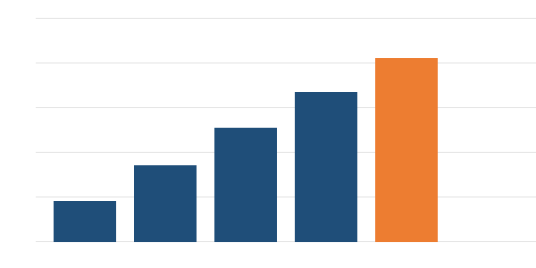

# Resumen ejecutivo

## Estado general

El proyecto **Planta de Espesado Norte** cierra el tercer trimestre con un avance físico acumulado de **82 %**, frente a un 85 % planificado. La desviación de tres puntos se explica por la demora en la llegada de las bombas de relave y no compromete, por ahora, la fecha de puesta en marcha del 28 de febrero de 2027.

El costo real acumulado alcanza los *CLP 3.412 millones*, un 1,3 % bajo el presupuesto vigente de CLP 3.458 millones para la misma fecha de corte.

## Hitos del trimestre

| Hito | Fecha comprometida | Avance | Estado |
|---|---|---|---|
| Montaje de estructuras del espesador | 15-08-2026 | 100 % | Verde |
| Instalación de bombas de relave | 30-09-2026 | 70 % | Amarillo |
| Tendido de cable de fuerza y control | 20-10-2026 | 55 % | Amarillo |
| Pruebas hidrostáticas de cañerías | 10-11-2026 | 20 % | Rojo |

# Avance del período

## Avance físico

El avance acumulado por mes muestra una aceleración sostenida desde julio, con el mayor aporte en las obras civiles y el montaje mecánico.

### Detalle por disciplina

- Obras civiles: **96 %**, a la espera de la última losa de la zona de descarga.
- Montaje mecánico: **84 %**, con el espesador principal ya alineado.
- Piping: **61 %**, condicionado por el despacho de válvulas importadas.
- Electricidad e instrumentación: **55 %**, con las bandejas ya instaladas.

## Costos

| Partida | Presupuesto (MM CLP) | Real (MM CLP) | Desviación |
|---|---|---|---|
| Obras civiles | 1.120 | 1.098 | -2,0 % |
| Equipos principales | 1.540 | 1.572 | +2,1 % |
| Montaje y piping | 520 | 478 | -8,1 % |
| Electricidad e instrumentación | 278 | 264 | -5,0 % |

# Riesgos y próximos pasos

## Riesgos principales

1. Retraso en el despacho de las bombas de relave: puede mover la puesta en marcha entre dos y tres semanas.
2. Disponibilidad de soldadores calificados durante noviembre y diciembre.
3. Condiciones climáticas adversas en la faena durante el invierno altiplánico.

## Próximos pasos

### Noviembre

Completar la instalación de las bombas, cerrar el tendido de cable principal y reprogramar las pruebas hidrostáticas con el contratista de piping.

### Diciembre

Iniciar la precomisión de los sistemas eléctricos y emitir las bases de la capacitación de operadores.

# Anexos

## Cronograma detallado

El cronograma de línea base y el vigente se mantienen en la carpeta del proyecto. La ruta crítica pasa hoy por el despacho de bombas, las pruebas hidrostáticas y la precomisión eléctrica, en ese orden.

## Matriz de riesgos

| Riesgo | Probabilidad | Impacto | Responsable |
|---|---|---|---|
| Retraso de bombas de relave | Alta | Alto | M. Fuentes |
| Falta de soldadores calificados | Media | Medio | C. Paredes |
| Clima adverso en faena | Media | Bajo | J. Cárdenas |
